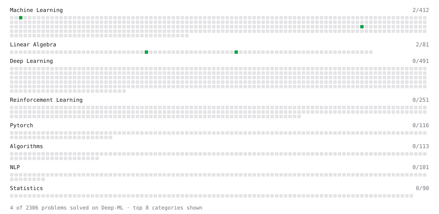

# Deep-ML

My machine learning practice from [Deep-ML](https://www.deep-ml.com). Every solution here was written by hand.

**5** solved · 5 problems · 0 labs · 0 math

[**Browse the interactive portfolio**](https://madara88645.github.io/deep-ml/) to replay this filling in over time.

## Problems

| | Difficulty | Solved | |
| --- | --- | --- | --- |
| [Compute the Cross Product of Two 3D Vectors](https://www.deep-ml.com/problems/118) | easy | 2026-11-14 | [solution](problems/0118-compute-the-cross-product-of-two-3d-vectors) |
| [Feature Scaling Implementation](https://www.deep-ml.com/problems/16) | easy | 2026-11-14 | [solution](problems/0016-feature-scaling-implementation) |
| [L2 Normalization Along an Axis](https://www.deep-ml.com/problems/1022) | easy | 2026-11-14 | [solution](problems/1022-l2-normalization-along-an-axis) |
| [Pairwise Cosine Similarity Matrix](https://www.deep-ml.com/problems/1072) | easy | 2026-11-15 | [solution](problems/1072-pairwise-cosine-similarity-matrix) |
| [Reshape Matrix](https://www.deep-ml.com/problems/3) | easy | 2026-11-18 | [solution](problems/0003-reshape-matrix) |

---

_This file is regenerated by Deep-ML on every push._
